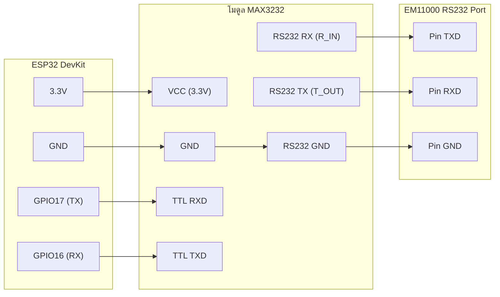

# คู่มือวิศวกรรม: โปรโตคอล Modbus RTU และการต่อใช้งาน Inverter EM11000 ด้วย ESP32

คู่มือฉบับนี้รวบรวมข้อมูลจากการทดสอบและดักจับสัญญาณจริง (Reverse Engineering & Protocol Tracing) ระหว่างปลั๊ก Wi-Fi เดิม (Eybond Architecture) กับ Inverter EM11000 เพื่อเป็นเอกสารอ้างอิงสำหรับการสร้างบอร์ดอ่านข้อมูลด้วย **ESP32 + MAX3232** หรือการทำ **Home Assistant Local Proxy**

---

## 1. ภาพรวมสถาปัตยกรรมระบบ (System Architecture)

```mermaid
flowchart TD
    subgraph Original_Flow["ระบบเดิมผ่านปลั๊ก Wi-Fi"]
        INV1["Inverter EM11000"] <-->|RS232 (9600 8N1)| PLUG["Wi-Fi Datalogger Plug<br/>(Eybond FW 3.6.6.6)"]
        PLUG <-->|TCP Port 18899| CLOUD["China Cloud<br/>(dtu_ess.eybond.com)"]
        CLOUD <--> APP["SmartESS / DESS Mobile App"]
    end

    subgraph ESP32_Direct["ระบบตรงด้วย ESP32 ในอนาคต"]
        INV2["Inverter EM11000"] <-->|RS232 (±12V)| MAX["MAX3232 Transceiver"]
        MAX <-->|TTL 3.3V (GPIO16/17)| ESP["ESP32 (ESPHome)"]
        ESP <-->|Wi-Fi / Native API (1s)| HA["Home Assistant / Lovelace Dashboard"]
    end
```

### การค้นพบสำคัญจากการทดสอบจริง
1. **ตัวปลั๊ก Wi-Fi เป็นเพียง Transparent Gateway:** 
   ปลั๊ก Wi-Fi เดิมไม่ได้คำนวณหรือแปลงข้อมูลเอง มันเพียงแค่รับเฟรม Modbus RTU จากเครือข่าย TCP (หุ้มด้วย Eybond Header 8 ไบต์) แล้วส่งต่อไปยังสายสัญญาณ RS232 เข้า Inverter โดยตรง
2. **Inverter EM11000 ใช้ Modbus RTU แท้:**
   ไม่รองรับคำสั่งตัวอักษร Voltronic ASCII (`QPIGS`, `QPI`) แต่ตอบสนองต่อ **Standard Modbus RTU (Slave Address: 1, Function Code: 0x03)** อย่างรวดเร็ว (Latency < 250ms)
3. **พฤติกรรม Silence-Drop (ตรวจจับข้อผิดพลาดเงียบ):**
   หากส่งเฟรมที่คำนวณ CRC ผิดแม้แต่ 1 บิต หรือตั้ง Baud Rate ผิด Inverter จะ **ทิ้งเฟรมทันทีโดยไม่ตอบ Error Code หรือ Exception ใดๆ กลับมาทั้งสิ้น** (นี่คือสาเหตุหลักที่ทำให้อุปกรณ์ทดสอบก่อนหน้านี้คิดว่า Inverter ไม่ตอบ)

---

## 2. การเชื่อมต่อฮาร์ดแวร์ (Hardware & Electrical Specifications)

> [!CAUTION]
> พอร์ตสื่อสารของ Inverter EM11000 เป็นระดับแรงดัน **RS232 แท้ (±5V ถึง ±12V)** ห้ามนำขา GPIO ของ ESP32 (3.3V) ต่อตรงเข้าพอร์ตอินเวอร์เตอร์โดยเด็ดขาด เพราะจะทำให้ขา ESP32 เสียหายทันที

### อุปกรณ์ที่ต้องใช้
1. **บอร์ด ESP32:** บอร์ด ESP32 DevKit ทั่วไป (เช่น ESP32-WROOM-32)
2. **โมดูลแปลงสัญญาณ:** **MAX3232** Mini Board (รองรับไฟ 3.3V)
3. **สายเชื่อมต่อ:** หัว RJ45 ตัวผู้ หรือ DB9 ตามพอร์ตของอินเวอร์เตอร์

### วงจรการต่อสาย (Wiring Diagram)



> [!IMPORTANT]
> **ข้อผิดพลาดที่พบบ่อย & ตัวเลือกโมดูล SP3232 แบบแถบยาว (SP3232 Strip Module):**
> * **การต่อโมดูล SP3232 แบบแถบยาว (ตัวยาวสีน้ำเงิน):**
>   * ฝั่ง TTL: ต่อ `VCC` เข้า 3.3V, `GND` เข้า GND, `TxIN` (ลูกศรชี้เข้า) เข้า `GPIO17 (TX)` ของ ESP32, `RxOUT` (ลูกศรชี้ออก) เข้า `GPIO16 (RX)` ของ ESP32
>   * ฝั่ง RS232: ต่อ `TxOUT` เข้า RXD ของ Inverter, `RxIN` เข้า TXD ของ Inverter, `GND` เข้า GND ของ Inverter
> * **กรณีใช้โมดูลแปลงไฟแยกกัลวานิก B0505S:** หากใช้ B0505S จ่ายไฟแยกให้ SP3232 จะต้องมีโมดูลแยกสัญญาณดิจิทัลแม่เหล็กความเร็วสูง **ADuM1201** คั่นกลางระหว่างขา GPIO ของ ESP32 กับ SP3232 เสมอ ห้ามต่อสายสัญญาณ logic ตรงเด็ดขาด เพราะกราวด์ลอยจะทำให้ส่งข้อมูลไม่ผ่าน
> * **การต่อตรงแบบไม่แยกกราวด์ (แนะนำ):** ต่อ 3.3V และ GND ร่วมกับ ESP32 ตรงๆ (ไม่ใช้ B0505S) ได้ทันทีเนื่องจากระยะสายสั้น ไม่มีปัญหากราวด์ลูปกวนระบบ

---

## 3. สรุปพารามิเตอร์การสื่อสาร (Communication Parameters)

* **Physical Layer:** RS232 Standard
* **Baud Rate:** `9600` bps
* **Data Bits:** `8`
* **Parity:** `None`
* **Stop Bits:** `1` (`9600 8N1`)
* **Slave ID (Modbus Device Address):** `1` (`0x01`)
* **Function Code:** `0x03` (Read Holding Registers)
* **Maximum Chunk Size:** Inverter รองรับการอ่านพร้อมกันได้สูงสุดถึง **100 Registers (200 ไบต์)** ใน 1 คำสั่ง

---

## 4. แผนผัง Register และเฟรม Hex ตัวอย่าง (Verified Register Map)

ตารางด้านล่างคือคำสั่งและค่าที่ได้จากการยิงทดสอบจริงกับเครื่อง Inverter EM11000:

| ชนิดข้อมูล | Register Address (Dec) | Address (Hex) | ตัวอย่างค่าที่อ่านได้ | ตัวคูณ (Scale) | หน่วย | คำอธิบาย |
|---|:---:|:---:|:---:|:---:|:---:|---|
| **Battery Voltage** | `198` | `0x00C6` | `597` | $\times 0.1$ | V | แรงดันแบตเตอรี่ (59.7 V) |
| **Grid Frequency** | `203` | `0x00CB` | `5003` | $\times 0.01$ | Hz | ความถี่ไฟการไฟฟ้า (50.03 Hz) |
| **Grid / AC Output Volt** | `254` | `0x00FE` | `1927` | $\times 0.1$ | V | แรงดันไฟ AC ฝั่ง Output / Grid |
| **AC Output Frequency** | `253` | `0x00FD` | `5003` | $\times 0.01$ | Hz | ความถี่ไฟ AC ฝั่ง Inverter |
| **Inverter Operating Mode** | `184` | `0x00B8` | `3` | 1 | - | โหมดการทำงาน (Line/Battery/Bypass) |
| **PV1 Voltage** | `302` | `0x012E` | `972` | $\times 0.1$ | V | แรงดันแผงโซลาร์เซลล์ชุดที่ 1 (97.2 V) |
| **PV2 Voltage / Bus** | `303` | `0x012F` | `917` | $\times 0.1$ | V | แรงดันแผงชุดที่ 2 หรือ Bus Voltage |
| **Output Current** | `304` | `0x0130` | `180` | $\times 0.1$ | A | กระแสโหลดขาออก (18.0 A) |
| **Output Frequency** | `305` | `0x0131` | `49` หรือ `50` | 1 | Hz | ความถี่กระแสสลับ (49-50 Hz) |
| **Datalogger SN (ASCII)** | `186 - 192` | `0x00BA - 0x00C0` | `<YOUR_PLUG_SN>` | Text | - | Serial Number ประจำตัวปลั๊ก (14 Bytes) |
| **Inverter Model Code** | `171` | `0x00AB` | `29440` (`0x7300`)| Hex | - | รหัสรุ่นเครื่อง EM11000 |

---

## 5. บัญชีเฟรม Hex สำหรับการทดสอบ (Raw Modbus RTU Frames)

สำหรับการนำไปทดสอบด้วยโปรแกรมเช่น Modbus Poll, Python หรือ Serial Monitor:

### A. อ่านแรงดันแบตเตอรี่ (Battery Voltage - Reg 198)
* **TX Frame (ส่ง):** `01 03 00 C6 00 01 64 37`
* **RX Frame (ตอบ):** `01 03 02 02 55 79 1B`
  * `01` = Slave ID 1
  * `03` = Function Code 0x03
  * `02` = จำนวนไบต์ข้อมูล (2 ไบต์)
  * `02 55` = ค่าใน Register = 597 (59.7 V)
  * `79 1B` = CRC16 Checksum

### B. อ่านความถี่ไฟบ้าน (Grid Frequency - Reg 203)
* **TX Frame (ส่ง):** `01 03 00 CB 00 01 F5 C4`
* **RX Frame (ตอบ):** `01 03 02 13 8B B4 59`
  * `13 8B` = ค่าใน Register = 5003 (50.03 Hz)

### C. อ่านชุดข้อมูลโซลาร์เซลล์และโหลด (PV & Load Block - Reg 302 ถึง 305)
* **TX Frame (ส่ง 4 Registers):** `01 03 01 2E 00 04 25 FC`
* **RX Frame (ตอบ 8 ไบต์):** `01 03 08 03 AB 03 95 00 B5 00 30 D2 D4`
  * `03 AB` = Reg 302 = 939 (PV1: 93.9 V)
  * `03 95` = Reg 303 = 917 (PV2: 91.7 V)
  * `00 B5` = Reg 304 = 181 (Load Current: 18.1 A)
  * `00 30` = Reg 305 = 48 (Output Freq: 48-50 Hz)

---

## 6. โค้ดตัวอย่าง ESPHome YAML (Production Ready)

สามารถนำชุดคอนฟิกนี้ไปแฟลชลง ESP32 เพื่อดึงข้อมูลเข้า Home Assistant ได้ทันที:

```yaml
esphome:
  name: em11000-solar-bridge
  friendly_name: "EM11000 Inverter Bridge"

esp32:
  board: esp32dev
  framework:
    type: esp-idf

wifi:
  ssid: "YOUR_WIFI_SSID"
  password: "YOUR_WIFI_PASSWORD"

api:
  reboot_timeout: 0s

ota:
  - platform: esphome

logger:
  level: INFO
  baud_rate: 0  # ปิดการออก log ที่ UART เพื่อป้องกันสัญญาณชนกับ RS232

uart:
  id: uart_em11000
  tx_pin: GPIO17
  rx_pin: GPIO16
  baud_rate: 9600
  data_bits: 8
  parity: NONE
  stop_bits: 1

modbus:
  id: modbus_inverter
  uart_id: uart_em11000

modbus_controller:
  - id: em11000
    address: 1
    modbus_id: modbus_inverter
    setup_priority: -10
    update_interval: 2s  # สามารถตั้ง 1s - 5s ได้ตามต้องการ

sensor:
  # 1. แรงดันแบตเตอรี่ (Battery Voltage)
  - platform: modbus_controller
    modbus_controller_id: em11000
    name: "EM11000 Battery Voltage"
    address: 0x00C6
    register_type: holding
    value_type: U_WORD
    unit_of_measurement: "V"
    device_class: voltage
    state_class: measurement
    accuracy_decimals: 1
    filters:
      - multiply: 0.1

  # 2. ความถี่ไฟบ้าน (Grid Frequency)
  - platform: modbus_controller
    modbus_controller_id: em11000
    name: "EM11000 Grid Frequency"
    address: 0x00CB
    register_type: holding
    value_type: U_WORD
    unit_of_measurement: "Hz"
    device_class: frequency
    state_class: measurement
    accuracy_decimals: 2
    filters:
      - multiply: 0.01

  # 3. แรงดันแผงโซลาร์ชุดที่ 1 (PV1 Voltage)
  - platform: modbus_controller
    modbus_controller_id: em11000
    name: "EM11000 PV1 Voltage"
    address: 0x012E
    register_type: holding
    value_type: U_WORD
    unit_of_measurement: "V"
    device_class: voltage
    state_class: measurement
    accuracy_decimals: 1
    filters:
      - multiply: 0.1

  # 4. แรงดันแผงโซลาร์ชุดที่ 2 (PV2 Voltage)
  - platform: modbus_controller
    modbus_controller_id: em11000
    name: "EM11000 PV2 Voltage"
    address: 0x012F
    register_type: holding
    value_type: U_WORD
    unit_of_measurement: "V"
    device_class: voltage
    state_class: measurement
    accuracy_decimals: 1
    filters:
      - multiply: 0.1

  # 5. กระแสโหลด (Inverter Load Current)
  - platform: modbus_controller
    modbus_controller_id: em11000
    name: "EM11000 Load Current"
    address: 0x0130
    register_type: holding
    value_type: U_WORD
    unit_of_measurement: "A"
    device_class: current
    state_class: measurement
    accuracy_decimals: 1
    filters:
      - multiply: 0.1
```

---

## 7. กลยุทธ์การใช้งานคู่ขนาน (Dual-Routing Strategy)

ในกรณีที่ต้องการใช้งานทั้ง **Home Assistant ภายในบ้าน** และ **แอปจีน (SmartESS)** พร้อมกัน:
1. ปล่อยให้ปลั๊ก Wi-Fi เดิมของจีนเสียบคาไว้ตามปกติ
2. กำหนดให้ Home Assistant (`<HA_IP>`) ทำหน้าที่เป็น **Transparent Proxy (ผ่าน custom_components/em11000_bridge)**:
   * HA รับข้อมูลจากปลั๊กที่ Port `8899` ด้วยสปีดเร็วสูง 1-2 วินาที
   * HA ส่งต่อเฟรม Mirror ไปยังเซิร์ฟเวอร์จีน `8.218.202.213:18899` ทุกๆ 5 วินาที
3. **ผลลัพธ์:** แอปบนมือถือจะมองเห็นอินเวอร์เตอร์ออนไลน์ตลอดเวลา และ HA ก็จะได้ข้อมูลอัปเดตแบบ Real-time โดยไม่สูญเสียฟังก์ชันใดๆ ทั้งสองฝั่ง
