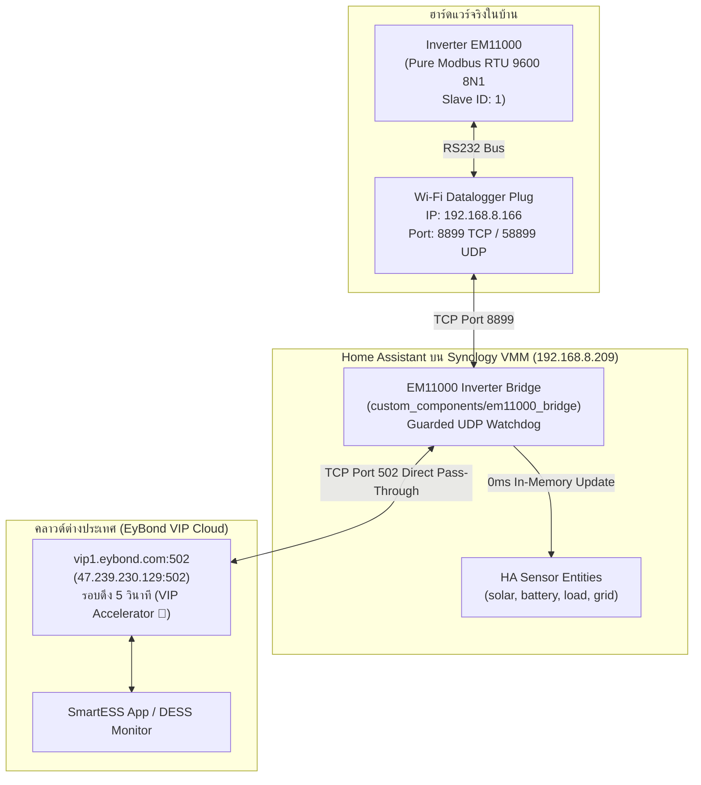

# คู่มือวิศวกรรมปฏิบัติการ: ระบบ Inverter EM11000 VIP Cloud Transparent Bridge บน Home Assistant (24/7)

> **บันทึกทางเทคนิค:** รวบรวมกระบวนการเชื่อมต่อและดักจับข้อมูล Inverter EM11000 ผ่านปลั๊ก Wi-Fi Datalogger สู่ Home Assistant (Native In-Memory Asyncio) พร้อมสตรีมขึ้น VIP Cloud ของจีน (Port 502) แบบคู่ขนาน 100% โดยไม่ต้องเปิดเครื่องคอมพิวเตอร์ทิ้งไว้

---

## 1. ที่มาและสถาปัตยกรรมระบบ (System Architecture)

### 1.1 ปัญหาเดิมและการค้นพบครั้งสำคัญ (The Port 502 Breakthrough)
* **Inverter EM11000** (MaxSky / ANENJI / PowMr Clone, Model Code `0x7300` / `29440`) ปกติส่งข้อมูลขึ้นเซิร์ฟเวอร์จีนผ่านปลั๊ก Wi-Fi Datalogger (`PN: 92B32409100334`, S/N ในชิป: `Q0032094972706`)
* **ข้อผิดพลาดในอดีต (The 18899 Myth):** 
  * เข้าใจผิดว่าเซิร์ฟเวอร์จีนรับข้อมูลที่พอร์ต `18899` (`dtu_ess.eybond.com:18899`)
  * แท้จริงแล้วพอร์ต **18899** เป็นพอร์ตสำหรับ **โมดูล 4G/GPRS (Cellular DTU)** ที่สื่อสารด้วยคำสั่งตัวอักษร **AT Command** (`AT+DTUPN?` / `AT+INTPARA58?`) ปลั๊ก Wi-Fi ซึ่งพูดภาษา Binary EyBond Protocol จึงคุยไม่รู้เรื่องและถูกตัดหลุดทุก 15 วินาที
  * **พอร์ตจริงของ VIP Cloud:** EyBond ใช้พอร์ต **`502`** (`vip1.eybond.com:502` หรือ `47.239.230.129:502`) เป็นพอร์ต Native Listener สำหรับปลั๊ก Wi-Fi โดยเฉพาะ ซึ่งรองรับ Binary Protocol (FC=1 Heartbeat และ FC=4 Modbus Tunnel) โดยตรง

### 1.2 โครงสร้างระบบปัจจุบัน (ทำงาน 24/7 บน Synology VMM Home Assistant)



---

## 2. รายการอุปกรณ์และพารามิเตอร์เครือข่าย

* **Inverter:** EM11000 (Model Code `0x7300`, Slave ID 1, 9600 8N1)
* **Wi-Fi Datalogger Plug:** IP `192.168.8.166`, MAC `EC:64:C9:D3:1B:99`, Barcode PN `92B32409100334`, Internal PN `Q0032094972706`, DevCode `258` (`0x0102`), FW `3.6.6.6`
* **Home Assistant Server:** `192.168.8.209:8123` (Synology VMM SSD Disk 1, Port 8899 Native Listener)
* **Router หลัก:** Cudy WR11000 (`192.168.8.1`, Auto-reboot 04:00 AM)
* **China VIP Cloud Endpoint:** `vip1.eybond.com:502` (`47.239.230.129:502`)
* **สถานะความทนทาน:** มี Guarded UDP Auto-Recovery ตรวจจับตลอด 24 ชม. เมื่อเราเตอร์รีบูตตอนตี 4 ปลั๊กจะดึงกลับมาหา HA เองภายใน 3.5 วินาที โดยไม่ชนกับทราฟฟิกข้อมูล

---

## 3. กลไกการทำงานของ Component (`custom_components/em11000_bridge`)

### 3.1 Transparent Pass-Through & In-Memory Intercept
1. เมื่อปลั๊กต่อเข้ามาที่ `0.0.0.0:8899` บน Home Assistant:
   * HA จะเปิด Socket Upstream ไปยัง `vip1.eybond.com:502`
   * สตรีมแพ็กเก็ตจากคลาวด์ส่งตรงไปยังปลั๊ก (คำสั่งอ่าน Modbus FC=4)
   * เมื่อปลั๊กส่งค่ากลับมา HA จะส่งต่อไปยังคลาวด์ทันที (เพื่อให้ SmartESS อัปเดตทุก 5 วินาที)
   * พร้อมทั้ง **แกะค่าไบนารี Modbus ในแรมสดๆ** เพื่ออัปเดตเซนเซอร์ของ Home Assistant แบบ Real-time (0ms Latency)

### 3.2 Guarded UDP Watchdog (ป้องกัน Socket Reset)
* ยิงคำสั่ง `set>server=192.168.8.209:8899;\r\n` ไปที่พอร์ต UDP `58899` **เฉพาะตอนที่ไม่ได้ต่อ Socket เท่านั้น (`if not self.client_connected.is_set()`)**
* เมื่อต่อติดแล้ว จะหยุดส่ง UDP ทันที เพื่อป้องกันไม่ให้ตัวปลั๊ก Reset TCP Socket ตัวเอง

---

## 4. ตาราง Modbus Register ที่ใช้งานจริง (Verified 100%)

| จุดวัดข้อมูล | Register (Dec) | Register (Hex) | ตัวคูณ (Scale) | ชนิดข้อมูล | หน่วย | คำอธิบาย |
|---|:---:|:---:|:---:|:---:|:---:|---|
| **Battery SOC** | `198` / `280` | `0x00C6` / `0x0118` | $\times 1$ | Unsigned 16-bit | `%` | เปอร์เซ็นต์แบตเตอรี่ |
| **Battery Voltage** | `277` | `0x0115` | $\times 0.1$ | Unsigned 16-bit | `V` | แรงดันแบตเตอรี่รวม |
| **Battery Current** | `278` | `0x0116` | $\times 0.1$ | Signed 16-bit | `A` | กระแสชาร์จ (+) / ดึงออก (-) |
| **Battery Power** | `279` | `0x0117` | $\times 1$ | Signed 16-bit | `W` | กำลังวัตต์แบตเตอรี่ |
| **Total PV Power** | `302` | `0x012E` | $\times 1$ | Unsigned 16-bit | `W` | กำลังผลิตแผงโซลาร์รวม |
| **AC Output Voltage**| `338` | `0x0152` | $\times 0.1$ | Unsigned 16-bit | `V` | แรงดันไฟขาออก 230V |
| **Grid Voltage** | `342` | `0x0156` | $\times 0.1$ | Unsigned 16-bit | `V` | แรงดันไฟหลวงขาเข้า |
| **Active Power** | `346` | `0x015A` | $\times 1$ | Unsigned 16-bit | `W` | กำลังไฟจ่ายโหลดจริง |
| **Load Percentage** | `348` | `0x015C` | $\times 1$ | Unsigned 16-bit | `%` | เปอร์เซ็นต์โหลดของอินเวอร์เตอร์ |
| **Inverter Temp** | `305` | `0x0131` | $\times 1$ | Unsigned 16-bit | `°C` | อุณหภูมิโมดูลอินเวอร์เตอร์ |
| **PV Temp** | `281` | `0x0119` | $\times 1$ | Unsigned 16-bit | `°C` | อุณหภูมิโมดูลชาร์จโซลาร์ |

---

## 5. การเปิดใช้งานและการกู้คืนระบบ (Disaster Recovery)

### 5.1 การเปิดใช้งานใน `configuration.yaml`
```yaml
# EM11000 VIP Cloud Transparent Bridge & High-Speed Inverter Telemetry
em11000_bridge:
```

### 5.2 การกู้คืนเมื่อเปลี่ยนเราเตอร์หรือ IP เปลี่ยน
หากปลั๊ก Wi-Fi ไม่ยอมต่อเข้ามาที่ HA:
1. ยิงแพ็กเก็ต UDP สั่งชี้เป้ามาที่ HA ด้วยคำสั่ง:
   ```text
   set>server=192.168.8.209:8899;\r\n
   ```
   ไปยัง IP `192.168.8.166:58899` (และ Broadcast `192.168.8.255:58899`)
2. ตัวปลั๊กจะสลับมาเชื่อมต่อ HA พอร์ต 8899 ทันที และระบบบริดจ์จะส่งข้อมูลขึ้น VIP Cloud ต่อเนื่องอัตโนมัติ
